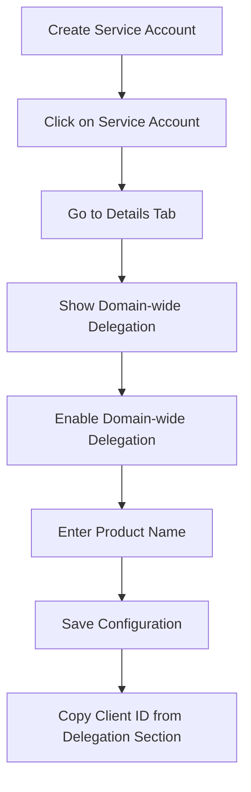

# Google Cloud Console UI Updates (January 2025)

## Important Changes to Domain-Wide Delegation Setup

Google has recently updated the Google Cloud Console interface for service accounts. This document highlights the key changes.

### What Changed?

#### Old Interface (2024)
- Domain-wide delegation was under "Show Advanced Settings"
- Single checkbox to enable
- Client ID shown in main view

#### New Interface (2025)
- Domain-wide delegation has its own section
- Requires OAuth consent screen configuration
- Multi-step process with product name
- Client ID shown in delegation section

### Updated Process Flow



### Key Points to Remember

1. **OAuth Consent Screen**: You now need to provide a product name when enabling domain-wide delegation
2. **Client ID Location**: The Client ID is now found specifically in the Domain-wide delegation section
3. **Two-Step Process**: Enabling delegation and configuring it are now separate steps
4. **Tab Navigation**: Look for the "Details" tab, not "Advanced Settings"

### Visual Guide

#### Step 1: Service Account Details Page
```
┌─────────────────────────────────────┐
│ Service Account: hpms-email-service │
├─────────────────────────────────────┤
│ Tabs: [Overview] [Details] [Keys]  │
│       [Permissions] [Metrics]       │
└─────────────────────────────────────┘
         ↓ Click "Details"
```

#### Step 2: Domain-wide Delegation Section
```
┌─────────────────────────────────────┐
│ Domain-wide delegation              │
├─────────────────────────────────────┤
│ Status: Not configured              │
│ [Show domain-wide delegation]       │
└─────────────────────────────────────┘
         ↓ Click to expand
```

#### Step 3: Enable and Configure
```
┌─────────────────────────────────────┐
│ Domain-wide delegation              │
├─────────────────────────────────────┤
│ [Enable domain-wide delegation]     │
│                                     │
│ Product name for consent screen:    │
│ [HPMS Email Service____________]    │
│                                     │
│ Client ID: 123456789012345678901    │
│ (Copy this for Admin Console)       │
└─────────────────────────────────────┘
```

### Common Issues with New Interface

1. **Can't Find Domain-Wide Delegation**
   - Make sure you're on the "Details" tab
   - Click "Show domain-wide delegation" to expand the section

2. **Product Name Required**
   - This is new - you must provide a name
   - Use something descriptive like "HPMS Email Service"
   - This appears on OAuth consent screens

3. **Client ID Not Visible**
   - Only appears after enabling delegation
   - Look in the expanded delegation section
   - Not shown in the main service account list anymore

### Tips for Smooth Setup

✅ **Before Starting**:
- Have your Google Workspace admin credentials ready
- Decide on a product name in advance
- Use Chrome or Edge browser (some users report issues with Firefox)

✅ **During Setup**:
- Take screenshots at each step
- Copy the Client ID immediately after it appears
- Don't close the tab until you've copied everything

✅ **After Setup**:
- Test immediately in Google Admin Console
- Document your Client ID in a secure location
- Set a calendar reminder to rotate keys in 90 days

### Need Help?

If you encounter issues with the new interface:
1. Clear browser cache and cookies
2. Try an incognito/private window
3. Ensure you're logged in with a Google Workspace admin account
4. Contact support with screenshots of where you're stuck