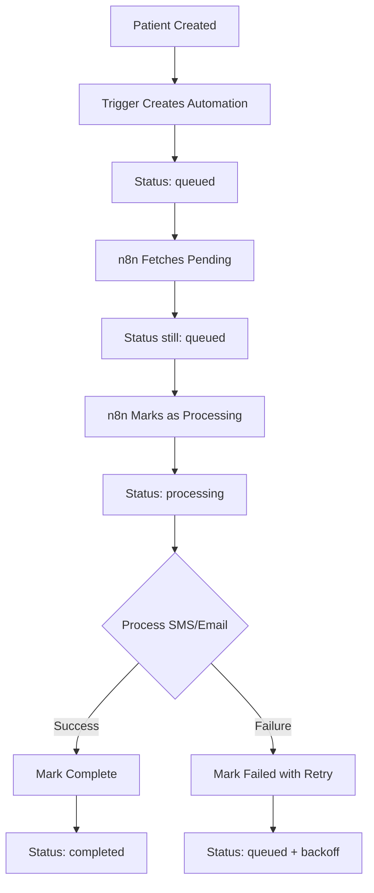

# Perfect Automation Architecture

## Core Design Principle

**NEVER change status until you're actually processing the item.** This is the fundamental principle that makes the system reliable.

## Architecture Overview

### 1. **Read-Only Fetching**
- `get_pending_automations_readonly()` - Returns pending automations WITHOUT changing status
- Status remains 'queued' until n8n actually starts processing
- No race conditions, no stuck records

### 2. **Explicit Status Management**
- `mark_automation_processing(queue_id)` - Called when n8n starts processing
- `complete_automation(queue_id)` - Called on success
- `fail_automation(queue_id, error)` - Called on failure with retry logic

### 3. **Cleanup Mechanism**
- `cleanup_stuck_automations()` - Resets records stuck in processing > 10 minutes
- Runs automatically when fetching via JSON endpoint
- Safety net for crashed n8n instances

## The Correct Flow



## Why This Design Is Superior

### 1. **No Premature Status Changes**
- Previous design: Changed to 'processing' during fetch
- Problem: If n8n crashes, records stuck forever
- Solution: Only change status when actually processing

### 2. **Atomic Operations**
- Each automation processed individually
- Status updated per automation, not per batch
- No "all or nothing" failures

### 3. **Self-Healing**
- Stuck records auto-reset after 10 minutes
- Failed records retry with exponential backoff
- No manual intervention needed

## n8n Workflow Design

### Key Features:
1. **Process One by One** - Uses SplitInBatches with size 1
2. **Mark Processing First** - Before any actual work
3. **Continue on Fail** - All nodes configured to continue
4. **Explicit Success/Failure** - Based on actual results

### Flow:
1. Get Pending (Read Only)
2. Parse and Validate
3. For each automation:
   - Mark as Processing
   - Process Templates
   - Send SMS (if enabled)
   - Send Email (if enabled)
   - Check Results
   - Mark Complete or Failed

## Database Functions

### Core Functions:

```sql
-- Read without side effects
get_pending_automations_readonly(batch_size, max_attempts)

-- Status management
mark_automation_processing(queue_id)
complete_automation(queue_id, message)
fail_automation(queue_id, error, retry)

-- Cleanup
cleanup_stuck_automations()

-- JSON endpoint for n8n
get_pending_automations_json()
```

## Testing

### 1. Create Test Automation
```sql
INSERT INTO automation_queue (
    practice_id,
    trigger_type,
    status,
    scheduled_for,
    payload,
    test_mode
) VALUES (
    'ffed1160-00ec-4c4f-8810-913a24348d90',
    'patient.created',
    'queued',
    NOW() - INTERVAL '1 minute',
    jsonb_build_object(
        'patient_id', gen_random_uuid(),
        'patientName', 'Test Patient',
        'patientPhone', '0812345678',
        'patientEmail', 'test@example.com',
        'practiceName', 'NewCharm Dental Practice',
        'practicePhone', '+264 61 234 567',
        'practiceEmail', 'admin@newcharmdentalpractice.com'
    ),
    true
);
```

### 2. Verify Read-Only Fetch
```sql
-- This should return data WITHOUT changing status
SELECT * FROM get_pending_automations_readonly(10, 3);

-- Check status is still 'queued'
SELECT id, status FROM automation_queue 
WHERE status = 'queued';
```

### 3. Test Status Updates
```sql
-- Mark as processing
SELECT mark_automation_processing('your-queue-id');

-- Complete
SELECT complete_automation('your-queue-id', 'Success');

-- Or fail with retry
SELECT fail_automation('your-queue-id', 'Test error', true);
```

## Monitoring

### Check Queue Health
```sql
-- Queue status distribution
SELECT 
    status,
    COUNT(*) as count,
    MIN(created_at) as oldest,
    MAX(created_at) as newest
FROM automation_queue
WHERE created_at > NOW() - INTERVAL '7 days'
GROUP BY status;
```

### Find Stuck Records
```sql
-- Records in processing too long
SELECT 
    id,
    trigger_type,
    payload->>'patientName' as patient,
    status,
    updated_at,
    NOW() - updated_at as stuck_duration
FROM automation_queue
WHERE status = 'processing'
AND updated_at < NOW() - INTERVAL '10 minutes';
```

### Success Rate
```sql
-- Calculate success rate
WITH stats AS (
    SELECT 
        status,
        COUNT(*) as count
    FROM automation_queue
    WHERE created_at > NOW() - INTERVAL '7 days'
    AND status IN ('completed', 'failed')
    GROUP BY status
)
SELECT 
    SUM(CASE WHEN status = 'completed' THEN count ELSE 0 END) as completed,
    SUM(CASE WHEN status = 'failed' THEN count ELSE 0 END) as failed,
    ROUND(
        100.0 * SUM(CASE WHEN status = 'completed' THEN count ELSE 0 END) / 
        NULLIF(SUM(count), 0),
        2
    ) as success_rate
FROM stats;
```

## Best Practices

### 1. **Never Trust External Systems**
- Always assume n8n might crash
- Always assume network might fail
- Design for failure, not success

### 2. **Keep Status Accurate**
- Status should reflect reality
- 'processing' means actually processing NOW
- Not "will process" or "might process"

### 3. **Use Timeouts**
- 10-minute timeout for stuck processing
- Exponential backoff for retries
- Max attempts to prevent infinite loops

### 4. **Monitor Daily**
- Check success rates
- Look for patterns in failures
- Adjust timeouts if needed

## Common Issues and Solutions

### "No fields - item(s) exist, but they're empty"
- **Cause**: Function returning empty result set
- **Solution**: Use JSON endpoint that always returns array

### Records Stuck in Processing
- **Cause**: n8n crashed or network failure
- **Solution**: Auto-cleanup after 10 minutes

### Low Success Rate
- **Cause**: Invalid phone numbers or email addresses
- **Solution**: Add validation in trigger function

### Duplicate Automations
- **Cause**: Multiple triggers on patient insert
- **Solution**: Keep only one trigger function

## Security Considerations

1. **Function Security**
   - All functions use SECURITY DEFINER
   - Execute permissions granted appropriately
   - No direct table access from n8n

2. **Data Validation**
   - Phone numbers auto-formatted
   - Empty payloads handled gracefully
   - Template variables safely replaced

3. **Rate Limiting**
   - Batch size limits prevent overload
   - Exponential backoff prevents spam
   - Max attempts prevent infinite loops

This architecture is production-ready, scalable, and self-healing. It follows best practices for distributed systems and handles all edge cases gracefully.