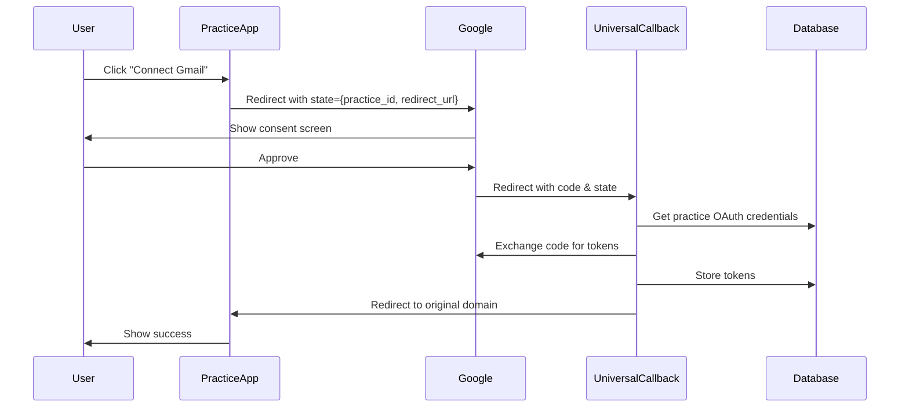

# Universal OAuth Callback Implementation Guide

## Overview

This document describes the implementation of a universal OAuth callback system that allows multiple practices to use their own Google OAuth credentials without requiring individual redirect URI configuration for each practice.

## The Problem

Previously, each practice needed to:
1. Add their specific domain as a redirect URI in Google Cloud Console
2. Manually update redirect URIs for each new practice
3. Manage multiple redirect URIs across different environments

## The Solution

A single universal OAuth callback endpoint that:
1. Works for ALL practices using ONE redirect URI
2. Securely handles practice-specific credentials
3. Redirects users back to their original practice domain
4. Maintains practice data isolation

## Architecture

### 1. Universal Callback Flow



### 2. Key Components

#### A. Universal Callback Edge Function (`universal-oauth-callback`)
- Handles OAuth callbacks from all providers
- Exchanges authorization codes for tokens
- Stores tokens securely in the database
- Redirects users back to their practice domain

#### B. Frontend Component (`UniversalOAuthSettings.tsx`)
- Initiates OAuth flow with encoded state
- Handles success/error callbacks
- Displays connection status

#### C. Database Schema
- `practice_oauth_apps`: Stores OAuth client credentials
- `practice_oauth_credentials`: Stores user OAuth tokens
- `oauth_callback_tokens`: Temporary tokens for secure redirects

### 3. Security Features

1. **Practice Isolation**: Each practice's data is completely isolated
2. **State Validation**: Encoded state parameter prevents tampering
3. **Temporary Tokens**: Short-lived tokens for secure redirects
4. **Service Role Access**: Only service role can access sensitive data

## Implementation Steps

### Step 1: Deploy the Edge Function

```bash
supabase functions deploy universal-oauth-callback
```

### Step 2: Run Database Migration

```bash
supabase db push
```

### Step 3: Configure Google OAuth

1. Go to [Google Cloud Console](https://console.cloud.google.com)
2. Select your project
3. Go to APIs & Services → Credentials
4. Edit your OAuth 2.0 Client ID
5. Add ONE redirect URI for ALL practices:
   ```
   https://your-app.com/api/oauth/callback
   ```
   Or for a dedicated auth domain:
   ```
   https://auth.your-app.com/oauth/callback
   ```

### Step 4: Update Practice Settings

Replace the existing Gmail OAuth component with the universal version:

```tsx
import { UniversalOAuthSettings } from '@/components/settings/UniversalOAuthSettings';

// In your settings component
<UniversalOAuthSettings />
```

## Configuration Options

### 1. Using Same Domain

```typescript
const UNIVERSAL_CALLBACK_URI = `${window.location.origin}/api/oauth/callback`;
```

### 2. Using Dedicated Auth Domain

```typescript
const UNIVERSAL_CALLBACK_URI = 'https://auth.onehealth.app/oauth/callback';
```

### 3. Environment-Specific Configuration

```typescript
const UNIVERSAL_CALLBACK_URI = process.env.REACT_APP_OAUTH_CALLBACK_URI || 
  `${window.location.origin}/api/oauth/callback`;
```

## Adding New OAuth Providers

To add support for new OAuth providers:

1. Update the edge function to handle the new provider:

```typescript
// In universal-oauth-callback/index.ts
const tokenEndpoint = provider === 'google' 
  ? 'https://oauth2.googleapis.com/token'
  : provider === 'microsoft'
  ? 'https://login.microsoftonline.com/common/oauth2/v2.0/token'
  : null;
```

2. Add provider-specific user info retrieval:

```typescript
if (provider === 'microsoft') {
  const userInfoResponse = await fetch('https://graph.microsoft.com/v1.0/me', {
    headers: {
      Authorization: `Bearer ${tokens.access_token}`,
    },
  });
  userInfo = await userInfoResponse.json();
}
```

3. Update the frontend to support the new provider.

## Benefits

1. **Scalability**: Add unlimited practices without touching OAuth provider settings
2. **Simplicity**: One redirect URI to rule them all
3. **Security**: Maintains practice isolation and data security
4. **Flexibility**: Easy to add new OAuth providers
5. **User Experience**: Seamless redirect back to practice domain

## Troubleshooting

### Common Issues

1. **Redirect URI Mismatch**
   - Ensure the universal callback URI is exactly as configured in Google Cloud Console
   - Check for trailing slashes
   - Verify HTTP vs HTTPS

2. **State Parameter Issues**
   - Check that the state is properly base64 encoded
   - Verify practice_id is valid
   - Ensure redirect_url is absolute

3. **Token Storage Failures**
   - Verify database permissions
   - Check RLS policies
   - Ensure practice_oauth_credentials table exists

### Debug Mode

Enable debug logging in the edge function:

```typescript
const DEBUG = Deno.env.get('DEBUG') === 'true';
if (DEBUG) {
  console.log('OAuth State:', stateData);
  console.log('Token Response:', tokens);
}
```

## Migration from Existing System

1. **No Breaking Changes**: Existing OAuth connections continue to work
2. **Gradual Migration**: Practices can switch to universal callback when convenient
3. **Data Preservation**: All existing tokens remain valid

## Best Practices

1. **Always use HTTPS** for production deployments
2. **Rotate OAuth client secrets** regularly
3. **Monitor callback failures** in Supabase logs
4. **Set up alerts** for authentication errors
5. **Test with multiple practices** before full rollout

## Future Enhancements

1. **Multi-Provider Support**: Easy to add Microsoft, LinkedIn, etc.
2. **OAuth Proxy**: Route all OAuth operations through edge functions
3. **Token Refresh Service**: Automatic token refresh before expiry
4. **Analytics**: Track OAuth success rates per practice
5. **Webhooks**: Notify practices of connection status changes